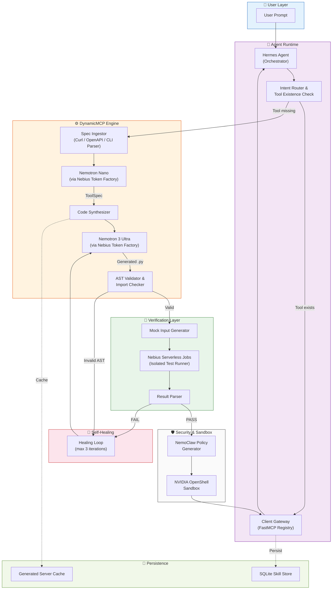
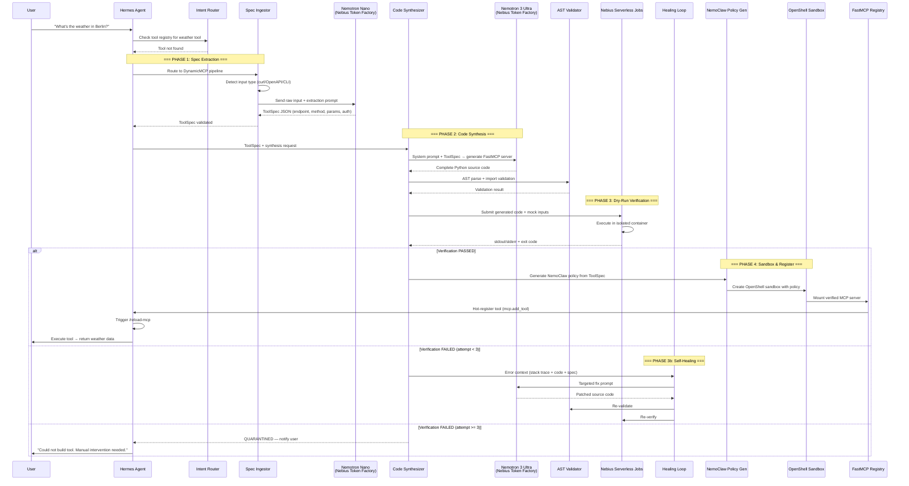
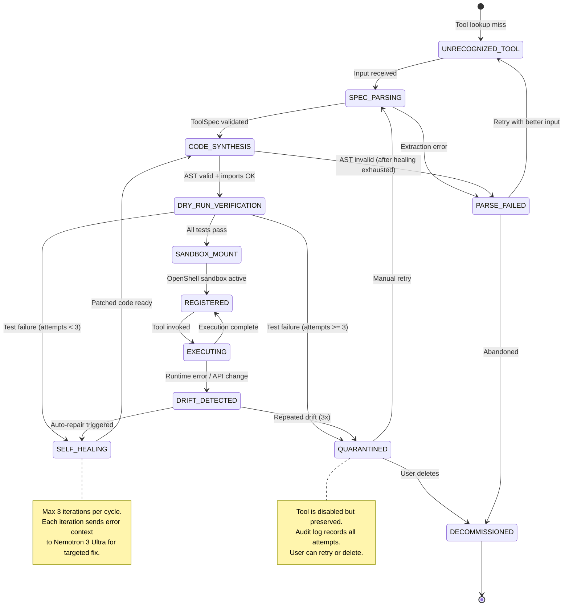
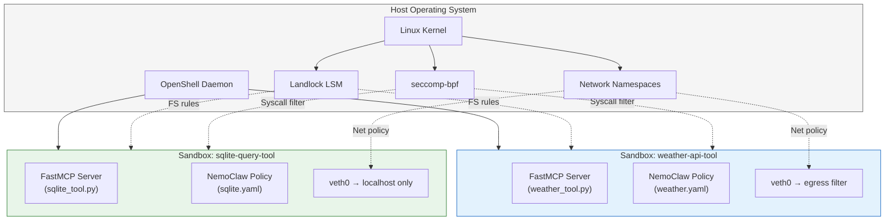
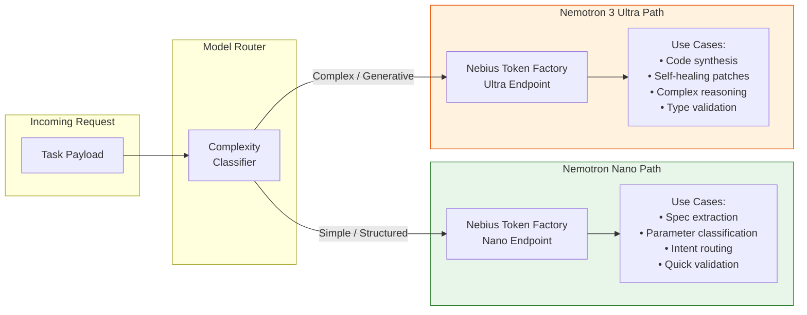
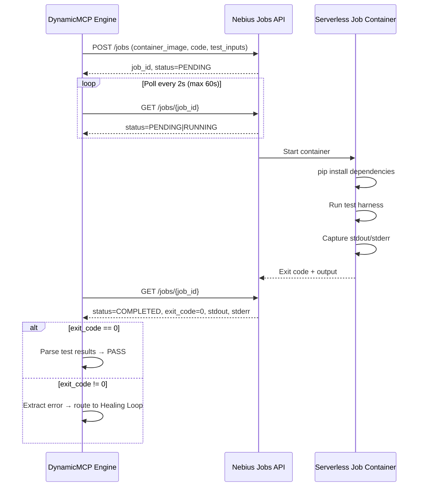
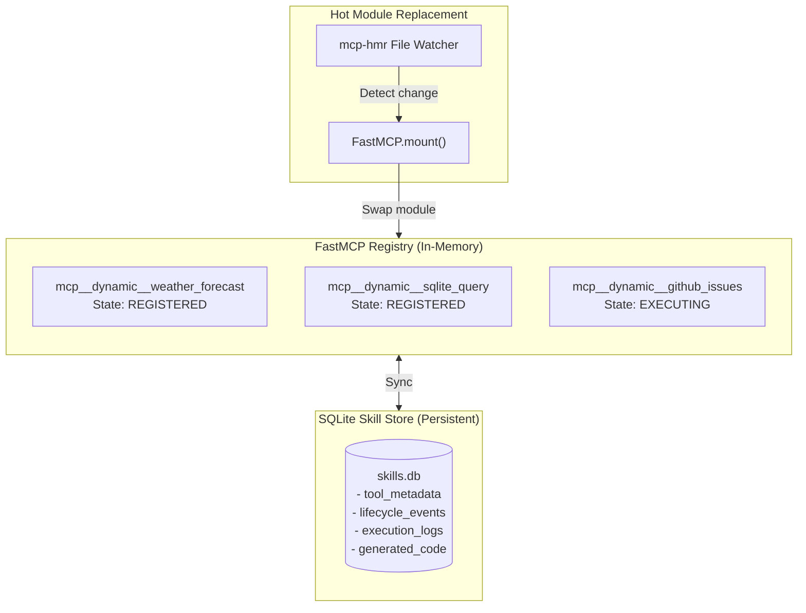
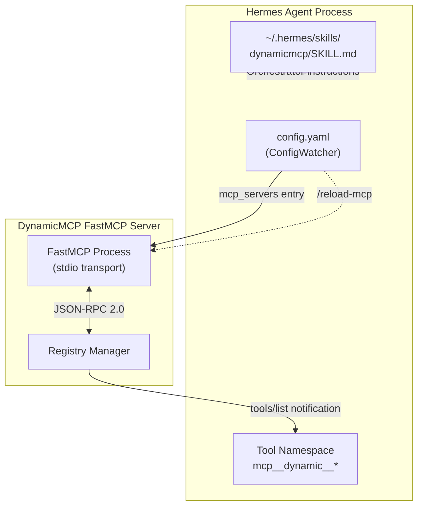
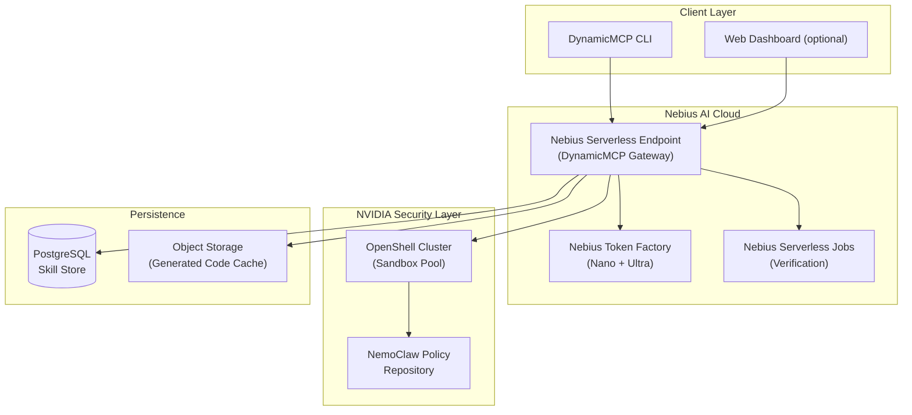

# DynamicMCP — System Architecture

> **Version:** 1.0.0 · **Track:** Personal AI (Nebius × NVIDIA Global Hackathon)
> **Status:** Design-Complete · Ready for Agent Implementation

---

## Table of Contents

1. [Executive Summary](#1-executive-summary)
2. [System Topology & Request Flow](#2-system-topology--request-flow)
3. [Dynamic Skill Life-Cycle State Machine](#3-dynamic-skill-life-cycle-state-machine)
4. [NVIDIA OpenShell & NemoClaw Security Boundaries](#4-nvidia-openshell--nemoclaw-security-boundaries)
5. [Nebius Token Factory & Compute Allocation](#5-nebius-token-factory--compute-allocation)
6. [FastMCP Dynamic Registry Architecture](#6-fastmcp-dynamic-registry-architecture)
7. [Hermes Agent Integration Layer](#7-hermes-agent-integration-layer)
8. [Data Flow & Persistence Architecture](#8-data-flow--persistence-architecture)
9. [Value-Add: Skill Marketplace & Sharing](#9-value-add-skill-marketplace--sharing)
10. [Deployment Topology](#10-deployment-topology)

---

## 1. Executive Summary

**DynamicMCP** is a self-assembling Model Context Protocol (MCP) server factory that turns any unfamiliar API, CLI tool, or data source into a fully typed, sandboxed, and hot-registered MCP tool — without human intervention. When an AI agent encounters an action it has no built-in tool for, DynamicMCP:

1. **Extracts** the target API spec from raw curl commands, OpenAPI fragments, or CLI help text using NVIDIA Nemotron Nano (fast, cost-efficient).
2. **Synthesizes** a complete FastMCP server with Pydantic models, exception handling, and descriptive docstrings using NVIDIA Nemotron 3 Ultra (deep reasoning).
3. **Verifies** the generated server in an isolated Nebius Serverless Job with synthetic test inputs.
4. **Self-heals** up to 3 times if verification fails, feeding stack traces back to Nemotron Ultra.
5. **Sandboxes** the verified server inside an NVIDIA OpenShell container with NemoClaw-enforced egress policies.
6. **Hot-registers** the tool into the live Hermes Agent session via FastMCP dynamic registration.

### Hackathon Alignment

| Requirement | How DynamicMCP Satisfies It |
|---|---|
| **Nebius Infrastructure** | All inference via Nebius Token Factory; async tests via Nebius Serverless Jobs |
| **NVIDIA Open-Source Model** | Nemotron Nano (spec extraction) + Nemotron 3 Ultra (code synthesis) |
| **Personal AI** | Always-on, zero-telemetry, per-user skill memory with persistent local SQLite store |
| **Privacy** | OpenShell sandboxing blocks credential leakage; NemoClaw egress policies prevent data exfiltration |

---

## 2. System Topology & Request Flow

### 2.1 High-Level Architecture Diagram



### 2.2 Request-Flow Sequence Diagram



### 2.3 Stage-by-Stage Breakdown

#### Stage 1: Intent Detection & Tool Existence Check

When the Hermes Agent receives a user prompt, the **Intent Router** performs a two-step check:

1. **Semantic classification** — Does the prompt require an external tool at all? (Pure reasoning or chitchat is handled natively.)
2. **Registry lookup** — Is a matching tool already registered in the FastMCP registry? The lookup is keyed on a normalized tool name derived from the inferred API domain or CLI command name.

If the tool exists and is in `REGISTERED` state, execution proceeds immediately through the OpenShell sandbox. If no tool matches, the router hands off to the DynamicMCP engine.

#### Stage 2: Spec Extraction (Nemotron Nano)

The **Spec Ingestor** accepts three input formats:

| Input Type | Parser | Example |
|---|---|---|
| Raw `curl` command | `CurlParser` | `curl -X GET "https://api.open-meteo.com/v1/forecast?latitude=52.52&longitude=13.41"` |
| OpenAPI / Swagger fragment | `OpenAPIParser` | YAML/JSON with `paths`, `components/schemas` |
| CLI `--help` output | `CLIHelpParser` | Text blob from `mytool --help` |

Each parser produces a partial `ToolSpec`. For ambiguous or incomplete inputs, the parsed fragments are sent to **Nemotron Nano** via the Nebius Token Factory for semantic completion. Nano is chosen for this stage because:
- Its 3.2B active parameters provide sufficient capability for structured extraction.
- Cost is ~10-17× lower than Ultra per token.
- Latency is sub-200ms for typical spec payloads (< 2K tokens).

#### Stage 3: Code Synthesis (Nemotron 3 Ultra)

The **Code Synthesizer** constructs a detailed prompt containing:
- The validated `ToolSpec` (JSON)
- A FastMCP template skeleton
- Pydantic model generation instructions
- Error handling requirements
- Tool docstring format

This prompt is sent to **Nemotron 3 Ultra** with `enable_thinking=True` for deep reasoning about:
- Correct HTTP method and header construction
- Input validation logic
- Response parsing and error mapping
- Type-safe Pydantic models for request/response

Ultra's 55B active parameters (from 550B total via LatentMoE routing) provide the reasoning depth needed for correct, production-quality code synthesis.

#### Stage 4: AST Validation

Before any execution, the generated Python source is validated:

1. **`ast.parse()`** — Catches syntax errors without executing the code.
2. **Import analysis** — Walks the AST to extract all `import` and `from ... import` statements, verifying each module is available in the sandbox environment.
3. **Security scan** — Rejects code containing `eval()`, `exec()`, `subprocess.Popen()`, `os.system()`, or raw `__import__()` calls.
4. **Schema conformance** — Verifies the code exports a `FastMCP` instance and at least one `@mcp.tool()` decorated function.

#### Stage 5: Dry-Run Verification (Nebius Serverless Jobs)

The validated code is submitted to a **Nebius Serverless Job** alongside:
- Synthetically generated mock inputs (based on the `ToolSpec` parameter schemas)
- A test harness that imports the generated module, calls each tool function, and captures results

The job runs in an isolated container with no network access to the target API (mocked responses are injected). The job lifecycle:
1. `PENDING` → Job queued in Nebius
2. `RUNNING` → Container started, test harness executing
3. `COMPLETED` → Exit code 0, all assertions passed
4. `FAILED` → Non-zero exit, or assertion errors in stdout

#### Stage 6: Self-Healing Loop

If verification fails, the **Healing Loop** extracts:
- The full stack trace from stderr
- The original `ToolSpec`
- The generated source code
- The specific test that failed

This context is fed back to Nemotron 3 Ultra with a specialized fix prompt. The loop runs a maximum of 3 iterations. If all 3 fail, the tool enters `QUARANTINED` state and the user is notified.

#### Stage 7: Sandbox Deployment (OpenShell + NemoClaw)

The **NemoClaw Policy Generator** reads the `ToolSpec` to:
1. Extract the target API domain(s) for egress allowlisting.
2. Generate a YAML policy restricting all other network access.
3. Set filesystem to read-only except for `/tmp/workspace`.
4. Block access to sensitive host paths (`.ssh/`, `.env`, etc.).

The policy is applied via `openshell sandbox create --policy <path>`, and the verified MCP server is mounted into the sandbox.

#### Stage 8: Hot-Registration

The sandboxed MCP server is dynamically registered into the FastMCP registry using `mcp.add_tool()`. The Hermes Agent's `/reload-mcp` command is triggered to pick up the new tool. The original user prompt is then re-routed to the newly available tool.

---

## 3. Dynamic Skill Life-Cycle State Machine

### 3.1 State Diagram



### 3.2 State Definitions

| State | Description | Entry Trigger | Exit Trigger | Data Stored |
|---|---|---|---|---|
| `UNRECOGNIZED_TOOL` | A tool lookup returned no match for the inferred action. | Intent Router detects missing tool | Input routed to Spec Ingestor | `intent_hash`, `raw_input`, `timestamp` |
| `SPEC_PARSING` | Raw input is being parsed and/or sent to Nemotron Nano for spec extraction. | Raw input received | `ToolSpec` validated or parse error | `parser_type`, `raw_input`, `nano_request_id` |
| `CODE_SYNTHESIS` | Nemotron 3 Ultra is generating FastMCP server code from the ToolSpec. | Valid ToolSpec available | Generated code passes AST validation | `tool_spec_id`, `ultra_request_id`, `generated_code_hash` |
| `DRY_RUN_VERIFICATION` | Generated code is being tested in a Nebius Serverless Job. | AST-valid code produced | Test results received | `job_id`, `test_inputs`, `attempt_number` |
| `SELF_HEALING` | Test failures are being fed back to Ultra for code correction. | Test failure with attempts < 3 | Patched code ready for re-synthesis | `error_trace`, `attempt_count`, `patch_diff` |
| `SANDBOX_MOUNT` | Verified code is being deployed into an OpenShell sandbox. | All tests pass | Sandbox active and healthy | `sandbox_id`, `policy_hash`, `mount_path` |
| `REGISTERED` | Tool is live in the FastMCP registry and ready for execution. | Sandbox reports healthy | Tool invoked or drift detected | `tool_name`, `registry_entry_id`, `registered_at` |
| `EXECUTING` | Tool is actively processing a request inside the sandbox. | User invokes tool | Response returned or error | `execution_id`, `input_hash`, `started_at` |
| `DRIFT_DETECTED` | A runtime error suggests the target API has changed. | Unexpected HTTP status, schema mismatch, or timeout | Self-healing triggered or quarantined | `drift_type`, `error_details`, `drift_count` |
| `QUARANTINED` | Tool has failed too many times and is disabled. | 3 failed healing attempts | Manual retry or deletion | `quarantine_reason`, `all_error_logs` |
| `DECOMMISSIONED` | Tool has been permanently removed. | User deletes or abandons | Terminal state | `decommissioned_at`, `final_audit_log` |
| `PARSE_FAILED` | Spec extraction could not produce a valid ToolSpec. | Parser or Nano returns invalid output | Retry or abandonment | `parse_error`, `raw_input` |

### 3.3 Transition Guards

```python
# Transition guard logic (conceptual)
TRANSITION_GUARDS = {
    ("DRY_RUN_VERIFICATION", "SELF_HEALING"): lambda ctx: ctx.attempt_count < 3,
    ("DRY_RUN_VERIFICATION", "QUARANTINED"): lambda ctx: ctx.attempt_count >= 3,
    ("DRIFT_DETECTED", "SELF_HEALING"): lambda ctx: ctx.drift_count < 3,
    ("DRIFT_DETECTED", "QUARANTINED"): lambda ctx: ctx.drift_count >= 3,
    ("SELF_HEALING", "CODE_SYNTHESIS"): lambda ctx: ctx.patched_code is not None,
    ("SANDBOX_MOUNT", "REGISTERED"): lambda ctx: ctx.sandbox_health == "HEALTHY",
}
```

---

## 4. NVIDIA OpenShell & NemoClaw Security Boundaries

### 4.1 Isolation Architecture



### 4.2 Kernel Namespace Isolation Details

#### Landlock LSM (Filesystem)

Landlock is a Linux Security Module that restricts filesystem access without requiring root privileges. DynamicMCP leverages Landlock to:

- **Read-only root**: The entire root filesystem is mounted read-only inside each sandbox. The generated MCP server cannot modify system binaries, libraries, or configuration files.
- **Writable workspace**: Only `/tmp/workspace` inside the sandbox is writable, for temporary files during tool execution.
- **Blocked sensitive paths**: Explicit deny rules for:
  - `~/.ssh/` — prevents SSH key exfiltration
  - `~/.env`, `.env` — prevents environment variable leakage
  - `~/.config/` — prevents reading host agent configurations
  - `/proc/*/environ` — prevents reading other process environments
  - Any path containing `token`, `secret`, `credential`, or `key` in the filename

#### seccomp-bpf (Syscall Filtering)

A seccomp-bpf profile restricts which system calls the sandboxed process can make:

```json
{
  "defaultAction": "SCMP_ACT_ERRNO",
  "architectures": ["SCMP_ARCH_X86_64"],
  "syscalls": [
    {
      "names": [
        "read", "write", "open", "close", "stat", "fstat",
        "mmap", "mprotect", "munmap", "brk",
        "socket", "connect", "sendto", "recvfrom",
        "epoll_create1", "epoll_ctl", "epoll_wait",
        "futex", "clock_gettime", "nanosleep",
        "getpid", "getuid", "exit_group"
      ],
      "action": "SCMP_ACT_ALLOW"
    }
  ]
}
```

Critically **blocked** syscalls include:
- `execve` (except for the Python interpreter itself)
- `ptrace` (prevents debugging/tracing other processes)
- `mount`, `umount2` (prevents filesystem manipulation)
- `clone` with `CLONE_NEWUSER` (prevents user namespace creation)
- `keyctl` (prevents kernel keyring access)

#### Network Namespaces (Egress Control)

Each sandbox runs in its own network namespace with a virtual ethernet pair (`veth`). Outbound traffic is filtered by iptables rules generated from the NemoClaw policy:

```bash
# Example: weather-api-tool sandbox
# Allow DNS resolution
iptables -A OUTPUT -p udp --dport 53 -j ACCEPT
# Allow HTTPS to target API only
iptables -A OUTPUT -p tcp --dport 443 -d api.open-meteo.com -j ACCEPT
# Drop everything else
iptables -A OUTPUT -j DROP
```

### 4.3 NemoClaw Policy Specification

A complete NemoClaw policy for a weather API tool:

```yaml
# policies/tools/weather_api.yaml
version: "1.0"
sandbox:
  name: "weather-api-tool"
  agent_harness: "hermes"
  description: "Open-Meteo weather forecast API tool"

security_policy:
  default_action: "deny"
  
  # Filesystem boundaries
  filesystem:
    readonly_paths:
      - "/usr"
      - "/lib"
      - "/lib64"
      - "/etc/ssl"
      - "/etc/resolv.conf"
    writable_paths:
      - "/tmp/workspace"
    blocked_paths:
      - "/home/*/.ssh"
      - "/home/*/.env"
      - "/home/*/.config"
      - "/home/*/.gnupg"
      - "/proc/*/environ"
      - "/etc/shadow"
      - "/etc/passwd"
    blocked_patterns:
      - "**/.*token*"
      - "**/.*secret*"
      - "**/.*credential*"
      - "**/.*key.pem"
  
  # Network egress rules (default-deny)
  network:
    allowed_domains:
      - "api.open-meteo.com"
    allowed_ports:
      - 443
    blocked_domains:
      - "*.internal"
      - "metadata.google.internal"
      - "169.254.169.254"
    dns_allowed: true
  
  # Process execution constraints
  process:
    allowed_binaries:
      - "/usr/bin/python3"
      - "/usr/local/bin/python3"
    max_processes: 4
    max_memory_mb: 512
    max_cpu_seconds: 30
  
  # Credential injection (zero-trust)
  credentials:
    injection_mode: "header"
    inject_only_for:
      - domain: "api.open-meteo.com"
        header: "Authorization"
        secret_ref: "vault://weather-api/key"
  
  # Integration presets
  presets:
    - name: "python-runtime"
      enabled: true
    - name: "dns-resolution"
      enabled: true
    - name: "brave-search"
      enabled: false
    - name: "shell-access"
      enabled: false

audit:
  log_level: "info"
  log_destination: "/tmp/workspace/audit.jsonl"
  record_network_requests: true
  record_file_access: true
```

### 4.4 Zero-Trust Credential Injection

OpenShell implements credential injection as follows:

```
┌──────────────────────────────────────────────────────────┐
│                    Sandbox Container                      │
│                                                          │
│  MCP Server → httpx.get("https://api.example.com/data") │
│      │                                                    │
│      ▼                                                    │
│  [Outbound Request - NO credentials attached]            │
│      │                                                    │
└──────┼───────────────────────────────────────────────────┘
       │
       ▼
┌──────────────────────────────────────────────────────────┐
│               OpenShell Egress Interceptor                │
│                                                          │
│  1. Check: Is api.example.com in allowed_domains?  ✅    │
│  2. Check: Does policy define credentials for this       │
│     domain?  ✅                                          │
│  3. Fetch secret from vault (secret_ref)                 │
│  4. Inject: Add "Authorization: Bearer <token>" header   │
│  5. Forward request to destination                       │
│                                                          │
│  ❌ If domain NOT in allowed_domains → DROP + LOG        │
└──────────────────────────────────────────────────────────┘
```

The MCP server code never contains, sees, or handles API keys. The generated code simply makes plain HTTP requests, and OpenShell's egress interceptor injects credentials transparently.

### 4.5 Threat Model

| # | Attack Vector | Description | Mitigation | Enforcement Layer |
|---|---|---|---|---|
| T1 | **Prompt Injection → Code Injection** | Malicious user input causes Nemotron Ultra to generate code with `os.system()` or `eval()` | AST security scan blocks dangerous constructs before execution | AST Validator |
| T2 | **Data Exfiltration via Network** | Generated tool sends sensitive data to attacker-controlled domain | NemoClaw egress policy allows only the target API domain; all other traffic dropped | Network Namespace + iptables |
| T3 | **Credential Theft** | Generated code attempts to read `.ssh/`, `.env`, or process environ | Landlock blocks access to sensitive paths; credentials never inside sandbox | Landlock LSM + Zero-Trust Injection |
| T4 | **Privilege Escalation** | Generated code attempts to escape sandbox via `ptrace`, `clone(NEWUSER)`, or mount | seccomp-bpf blocks all privilege-escalation syscalls | seccomp-bpf |
| T5 | **Resource Exhaustion (DoS)** | Generated tool runs infinite loop or allocates unbounded memory | NemoClaw `max_cpu_seconds` and `max_memory_mb` limits; killed after 30s / 512MB | Process cgroups via OpenShell |
| T6 | **Supply Chain Attack** | Generated code imports a malicious package not in the sandbox | Import analysis during AST validation; sandbox has minimal Python environment | AST Validator + Read-Only Root |
| T7 | **Cloud Metadata Exfiltration** | Generated code queries cloud metadata endpoint (169.254.169.254) | Explicitly blocked in NemoClaw `blocked_domains` | Network Namespace |
| T8 | **Tool Poisoning** | Attacker crafts API spec that generates a backdoored tool | Dry-run verification in Nebius Jobs catches unexpected behavior; 3-attempt healing limit prevents infinite retry loops | Verification Runner + Healing Guard |
| T9 | **Sandbox Escape via Shared Filesystem** | Tool writes to a path shared with the host | All host paths read-only; writable only in `/tmp/workspace` which is per-sandbox | Landlock LSM |
| T10 | **Telemetry Leakage** | System inadvertently reports tool usage to external services | No telemetry endpoints in any NemoClaw policy; all logging is local-only | NemoClaw Network Policy |

---

## 5. Nebius Token Factory & Compute Allocation

### 5.1 Model Routing Architecture



### 5.2 Model Comparison & Routing Decision Matrix

| Criterion | Nemotron Nano | Nemotron 3 Ultra | Routing Rule |
|---|---|---|---|
| **Architecture** | Hybrid Mamba-Transformer MoE | Hybrid LatentMoE (Mamba-2 + MoE + Attention) + MTP | — |
| **Total Parameters** | ~31.6B | 550B | — |
| **Active Parameters** | ~3.2B per token | ~55B per token | — |
| **Context Window** | Up to 1M tokens | Up to 1M tokens (practical: 262K default) | — |
| **Relative Cost** | 1× (baseline) | ~10-17× Nano | Use Nano whenever possible |
| **Latency (typical)** | 50-200ms | 500ms-3s | Use Nano for real-time routing |
| **Spec Extraction** | ✅ Primary | ❌ Overkill | → Nano |
| **Code Generation** | ❌ Insufficient depth | ✅ Primary | → Ultra |
| **Error Triage** | ✅ Simple classification | ❌ Overkill | → Nano |
| **Self-Healing Patches** | ❌ Insufficient | ✅ Primary | → Ultra |
| **Intent Routing** | ✅ Primary | ❌ Overkill | → Nano |
| **Pydantic Model Design** | ❌ Insufficient | ✅ Primary | → Ultra |

### 5.3 Token Cost Optimization Strategy

```python
# src/dynamicmcp/config.py — Token routing configuration

from enum import Enum

class ModelTier(str, Enum):
    NANO = "nano"
    ULTRA = "ultra"

# Mapping of pipeline stages to model tiers
STAGE_MODEL_ROUTING: dict[str, ModelTier] = {
    "spec_extraction": ModelTier.NANO,       # ~500 input tokens, ~200 output
    "intent_classification": ModelTier.NANO,  # ~100 input tokens, ~20 output
    "parameter_validation": ModelTier.NANO,   # ~300 input tokens, ~100 output
    "code_synthesis": ModelTier.ULTRA,        # ~2000 input tokens, ~3000 output
    "self_healing": ModelTier.ULTRA,          # ~4000 input tokens, ~3000 output
    "error_classification": ModelTier.NANO,   # ~500 input tokens, ~50 output
    "docstring_generation": ModelTier.NANO,   # ~300 input tokens, ~200 output
}

# Per-tool average token budget
# Typical flow: 2 Nano calls + 1 Ultra call = ~600 Nano tokens + ~5000 Ultra tokens
# With self-healing (1 loop): +1 Ultra call = ~8000 Ultra tokens total
# Cost estimate: ~$0.003-0.01 per tool generation (at Nebius Token Factory rates)
```

### 5.4 Nebius Serverless Jobs — Verification Lifecycle



### 5.5 Job Submission & Polling Code

```python
# src/dynamicmcp/verification/runner.py — Core job interaction

import asyncio
import httpx
from pydantic import BaseModel
from enum import Enum

class JobStatus(str, Enum):
    PENDING = "PENDING"
    RUNNING = "RUNNING"
    COMPLETED = "COMPLETED"
    FAILED = "FAILED"
    CANCELLED = "CANCELLED"

class JobResult(BaseModel):
    job_id: str
    status: JobStatus
    exit_code: int | None = None
    stdout: str = ""
    stderr: str = ""
    duration_seconds: float | None = None

class NebiusJobRunner:
    """Submits generated MCP server code to Nebius Serverless Jobs for verification."""

    def __init__(self, api_key: str, project_id: str, base_url: str):
        self.api_key = api_key
        self.project_id = project_id
        self.base_url = base_url.rstrip("/")
        self._client = httpx.AsyncClient(
            base_url=self.base_url,
            headers={"Authorization": f"Bearer {self.api_key}"},
            timeout=30.0,
        )

    async def submit_job(
        self,
        code: str,
        test_script: str,
        requirements: list[str],
    ) -> str:
        """Submit a verification job. Returns job_id."""
        payload = {
            "project_id": self.project_id,
            "container": {
                "image": "python:3.12-slim",
                "command": [
                    "bash", "-c",
                    f"pip install {' '.join(requirements)} && "
                    f"echo '{code}' > /tmp/tool.py && "
                    f"echo '{test_script}' > /tmp/test_tool.py && "
                    f"python -m pytest /tmp/test_tool.py -v --tb=short"
                ],
            },
            "resources": {
                "cpu": "1",
                "memory": "512Mi",
            },
            "timeout_seconds": 120,
        }
        resp = await self._client.post("/jobs", json=payload)
        resp.raise_for_status()
        return resp.json()["job_id"]

    async def poll_until_done(
        self,
        job_id: str,
        poll_interval: float = 2.0,
        max_wait: float = 120.0,
    ) -> JobResult:
        """Poll job status until completion or timeout."""
        elapsed = 0.0
        while elapsed < max_wait:
            resp = await self._client.get(f"/jobs/{job_id}")
            resp.raise_for_status()
            data = resp.json()
            status = JobStatus(data["status"])

            if status in (JobStatus.COMPLETED, JobStatus.FAILED):
                return JobResult(
                    job_id=job_id,
                    status=status,
                    exit_code=data.get("exit_code"),
                    stdout=data.get("stdout", ""),
                    stderr=data.get("stderr", ""),
                    duration_seconds=data.get("duration_seconds"),
                )

            await asyncio.sleep(poll_interval)
            elapsed += poll_interval

        return JobResult(
            job_id=job_id,
            status=JobStatus.FAILED,
            exit_code=-1,
            stderr=f"Job timed out after {max_wait}s",
        )

    async def close(self) -> None:
        await self._client.aclose()
```

### 5.6 Failover & Retry Logic

```python
# Retry strategy for Nebius API calls
from tenacity import (
    retry,
    stop_after_attempt,
    wait_exponential,
    retry_if_exception_type,
)

NEBIUS_RETRY_POLICY = retry(
    stop=stop_after_attempt(3),
    wait=wait_exponential(multiplier=1, min=2, max=30),
    retry=retry_if_exception_type((httpx.HTTPStatusError, httpx.ConnectTimeout)),
    before_sleep=lambda retry_state: logger.warning(
        f"Nebius API retry {retry_state.attempt_number}/3: {retry_state.outcome.exception()}"
    ),
)
```

If the Nebius Token Factory endpoint for Nemotron Ultra is temporarily unavailable:
1. Retry 3 times with exponential backoff (2s, 4s, 8s).
2. If Ultra remains unavailable, attempt with Nano (degraded quality, logged as warning).
3. If both are down, queue the task and notify the user.

---

## 6. FastMCP Dynamic Registry Architecture

### 6.1 Registry Structure



### 6.2 Dynamic Registration API

```python
# src/dynamicmcp/registry/manager.py

from fastmcp import FastMCP
from typing import Callable, Any
import importlib.util
import sys

class RegistryManager:
    """Manages the lifecycle of dynamically generated MCP tools."""

    NAMESPACE_PREFIX = "dynamic"

    def __init__(self, mcp_server: FastMCP):
        self._server = mcp_server
        self._registered_tools: dict[str, dict[str, Any]] = {}

    def register_tool(
        self,
        tool_name: str,
        tool_function: Callable,
        description: str,
        source_path: str,
    ) -> str:
        """Register a dynamically generated tool into the FastMCP server."""
        namespaced_name = f"{self.NAMESPACE_PREFIX}__{tool_name}"

        # Remove existing version if re-registering
        if namespaced_name in self._registered_tools:
            self._server.remove_tool(namespaced_name)

        # Register the new tool
        self._server.add_tool(
            tool_function,
            name=namespaced_name,
            description=description,
        )

        self._registered_tools[namespaced_name] = {
            "original_name": tool_name,
            "source_path": source_path,
            "registered_at": datetime.utcnow().isoformat(),
        }

        return namespaced_name

    def deregister_tool(self, tool_name: str) -> bool:
        """Remove a tool from the registry."""
        namespaced_name = f"{self.NAMESPACE_PREFIX}__{tool_name}"
        if namespaced_name in self._registered_tools:
            self._server.remove_tool(namespaced_name)
            del self._registered_tools[namespaced_name]
            return True
        return False

    def load_tool_from_file(self, source_path: str) -> Callable:
        """Dynamically import a generated tool module and extract its function."""
        spec = importlib.util.spec_from_file_location("dynamic_tool", source_path)
        module = importlib.util.module_from_spec(spec)
        sys.modules["dynamic_tool"] = module
        spec.loader.exec_module(module)

        # Find the tool function (decorated with @mcp.tool or has _mcp_tool marker)
        for attr_name in dir(module):
            attr = getattr(module, attr_name)
            if callable(attr) and hasattr(attr, "_tool_metadata"):
                return attr

        raise ValueError(f"No tool function found in {source_path}")

    def list_tools(self) -> list[dict[str, Any]]:
        """List all dynamically registered tools."""
        return [
            {"name": name, **meta}
            for name, meta in self._registered_tools.items()
        ]
```

### 6.3 Schema Versioning Strategy

Each generated tool is versioned using a content-addressable hash:

```python
import hashlib

def compute_tool_version(tool_spec_json: str, generated_code: str) -> str:
    """Compute a deterministic version hash for a generated tool."""
    content = f"{tool_spec_json}::{generated_code}"
    return hashlib.sha256(content.encode()).hexdigest()[:12]
```

When a tool is re-generated (e.g., after drift detection), the new version hash is compared to the existing one. If different, the old tool is deregistered and the new version is registered, preserving a full version history in SQLite.

---

## 7. Hermes Agent Integration Layer

### 7.1 Discovery & Routing Flow



### 7.2 Hermes Configuration Entry

```yaml
# ~/.hermes/config.yaml (relevant section)
mcp_servers:
  dynamicmcp:
    command: "python"
    args: ["-m", "dynamicmcp.cli", "serve"]
    env:
      NEBIUS_API_KEY: "${NEBIUS_API_KEY}"
      NEBIUS_PROJECT_ID: "${NEBIUS_PROJECT_ID}"
      DYNAMICMCP_DB_PATH: "~/.dynamicmcp/skills.db"
      DYNAMICMCP_CACHE_DIR: "~/.dynamicmcp/cache"
    transport: "stdio"
```

### 7.3 DynamicMCP Hermes Skill Definition

```markdown
---
name: dynamicmcp-orchestrator
description: >
  Automatically detects when a required tool is missing, synthesizes a new
  FastMCP server from API specs, verifies it in an isolated sandbox, and
  hot-registers it into the current session.
version: 1.0.0
author: DynamicMCP Team
platforms: [linux, macos]
metadata:
  hermes:
    tags: [Infrastructure, MCP, Automation, Security]
    requires_toolsets: [web, terminal]
    requires_tools: [terminal]
---

# DynamicMCP Orchestrator Skill

## When to Activate
Activate this skill when:
1. A user request requires an external API or CLI tool that is not in the current tool registry.
2. The user provides a raw curl command, OpenAPI spec, or CLI help text and asks to "make it a tool."
3. A tool execution fails due to API drift and self-healing is needed.

## Execution Steps
1. Identify the missing tool requirement from the user's intent.
2. Call `mcp__dynamicmcp__ingest_spec` with the raw input.
3. Wait for the synthesis pipeline to complete (status updates via `mcp__dynamicmcp__get_status`).
4. Once registered, re-execute the original user intent using the new tool.

## Available Tools
- `mcp__dynamicmcp__ingest_spec` — Submit raw API input for tool synthesis
- `mcp__dynamicmcp__get_status` — Check synthesis pipeline status
- `mcp__dynamicmcp__list_tools` — List all dynamically generated tools
- `mcp__dynamicmcp__deregister_tool` — Remove a generated tool
```

### 7.4 Session Persistence Across Hot-Reloads

When `/reload-mcp` is triggered:

1. **ConfigWatcher** detects the reload command.
2. The existing FastMCP stdio connection is **kept alive** (mcp-hmr handles module swapping without dropping the pipe).
3. New tools registered via `mcp.add_tool()` are immediately visible after reload.
4. The SQLite skill store persists tool metadata across Hermes agent restarts.
5. On Hermes startup, DynamicMCP automatically re-registers all tools in `REGISTERED` state from the SQLite store.

---

## 8. Data Flow & Persistence Architecture

### 8.1 SQLite Skill Store Schema

```sql
-- Database: ~/.dynamicmcp/skills.db

CREATE TABLE IF NOT EXISTS tools (
    id TEXT PRIMARY KEY,                    -- SHA-256 hash of tool_spec
    name TEXT NOT NULL UNIQUE,              -- Tool name (e.g., "weather_forecast")
    version TEXT NOT NULL,                  -- Content-addressable version hash
    state TEXT NOT NULL DEFAULT 'UNRECOGNIZED_TOOL',
    tool_spec_json TEXT NOT NULL,           -- Full ToolSpec as JSON
    generated_code TEXT,                    -- Generated Python source
    generated_code_hash TEXT,              -- SHA-256 of generated code
    policy_yaml TEXT,                       -- NemoClaw policy YAML
    sandbox_id TEXT,                        -- OpenShell sandbox ID
    source_type TEXT NOT NULL,              -- 'curl' | 'openapi' | 'cli_help'
    target_domain TEXT,                     -- Extracted API domain
    created_at TEXT NOT NULL DEFAULT (datetime('now')),
    updated_at TEXT NOT NULL DEFAULT (datetime('now')),
    registered_at TEXT,
    quarantined_at TEXT,
    quarantine_reason TEXT
);

CREATE TABLE IF NOT EXISTS lifecycle_events (
    id INTEGER PRIMARY KEY AUTOINCREMENT,
    tool_id TEXT NOT NULL REFERENCES tools(id),
    from_state TEXT NOT NULL,
    to_state TEXT NOT NULL,
    trigger TEXT NOT NULL,                  -- What caused the transition
    metadata_json TEXT,                     -- Additional context (error traces, etc.)
    created_at TEXT NOT NULL DEFAULT (datetime('now'))
);

CREATE TABLE IF NOT EXISTS execution_logs (
    id INTEGER PRIMARY KEY AUTOINCREMENT,
    tool_id TEXT NOT NULL REFERENCES tools(id),
    execution_id TEXT NOT NULL UNIQUE,
    input_hash TEXT NOT NULL,               -- SHA-256 of input parameters
    output_summary TEXT,                    -- Truncated output for audit
    duration_ms INTEGER,
    success INTEGER NOT NULL,               -- 0 or 1
    error_message TEXT,
    created_at TEXT NOT NULL DEFAULT (datetime('now'))
);

CREATE TABLE IF NOT EXISTS healing_attempts (
    id INTEGER PRIMARY KEY AUTOINCREMENT,
    tool_id TEXT NOT NULL REFERENCES tools(id),
    attempt_number INTEGER NOT NULL,        -- 1, 2, or 3
    error_trace TEXT NOT NULL,
    fix_prompt TEXT NOT NULL,               -- Prompt sent to Ultra
    patched_code TEXT,                      -- Code returned by Ultra
    verification_result TEXT,               -- PASS or FAIL
    created_at TEXT NOT NULL DEFAULT (datetime('now'))
);

-- Indexes for common queries
CREATE INDEX IF NOT EXISTS idx_tools_state ON tools(state);
CREATE INDEX IF NOT EXISTS idx_tools_name ON tools(name);
CREATE INDEX IF NOT EXISTS idx_lifecycle_tool_id ON lifecycle_events(tool_id);
CREATE INDEX IF NOT EXISTS idx_execution_tool_id ON execution_logs(tool_id);
```

### 8.2 Caching Strategy

```
~/.dynamicmcp/
├── skills.db                    # SQLite database
├── cache/
│   ├── specs/                   # Cached ToolSpec JSONs (keyed by input hash)
│   │   └── a3f2b1c9.json
│   ├── code/                    # Cached generated Python files
│   │   └── weather_forecast/
│   │       ├── v_a3f2b1c9.py   # Version-tagged source files
│   │       └── v_d4e5f6a7.py
│   └── policies/                # Cached NemoClaw policies
│       └── weather_forecast.yaml
└── logs/
    ├── pipeline.jsonl           # Structured pipeline log
    └── audit.jsonl              # Security audit log
```

Cache invalidation rules:
- **Spec cache**: Invalidated when the raw input hash changes.
- **Code cache**: Invalidated when the ToolSpec changes OR Ultra produces a different output (content-addressed by code hash).
- **Policy cache**: Regenerated whenever the ToolSpec's `target_domain` changes.
- **Max cache size**: 100 tools. LRU eviction based on `last_used_at`.

### 8.3 Audit Logging Format

All security-relevant events are logged in JSONL format:

```json
{
  "timestamp": "2026-10-24T18:30:00.123Z",
  "event_type": "TOOL_REGISTERED",
  "tool_id": "a3f2b1c9d4e5f6a7",
  "tool_name": "weather_forecast",
  "target_domain": "api.open-meteo.com",
  "sandbox_id": "sandbox-weather-001",
  "policy_hash": "d4e5f6a7b8c9d0e1",
  "egress_domains": ["api.open-meteo.com"],
  "blocked_paths": ["/home/*/.ssh", "/home/*/.env"],
  "actor": "pipeline:auto",
  "session_id": "sess-12345"
}
```

### 8.4 Observability (Zero-Leakage Compliant)

All telemetry stays **local**. No external analytics or crash-reporting endpoints.

| Signal | Implementation | Storage |
|---|---|---|
| **Structured logs** | Python `structlog` to JSONL files | `~/.dynamicmcp/logs/` |
| **Metrics** | In-process counters (tools generated, success rate, avg latency) | SQLite aggregation queries |
| **Health checks** | FastMCP endpoint `mcp__dynamicmcp__health` | In-memory |
| **Audit trail** | Every state transition logged with full context | SQLite `lifecycle_events` table |

---

## 9. Value-Add: Skill Marketplace & Sharing

> [!NOTE]
> This section describes an optional extension that adds value but is **not required** for the hackathon MVP. It is included as a design consideration for post-hackathon development.

### 9.1 Content-Addressable Tool Sharing

Since each generated tool is versioned by a content-addressable hash of its ToolSpec + generated code, tools can be shared across users without ambiguity:

```
tool://weather_forecast@a3f2b1c9d4e5
```

A shared tool package contains:
1. The `ToolSpec` JSON (sanitized — no credentials)
2. The generated Python source
3. The NemoClaw policy YAML
4. Verification results (test pass/fail log)
5. A trust score (based on: verified by original author, passed N test runs, uptime hours)

### 9.2 Trust Scoring

```python
def compute_trust_score(tool_id: str, db: SkillStore) -> float:
    """Compute trust score (0.0 - 1.0) for a generated tool."""
    executions = db.get_execution_count(tool_id)
    successes = db.get_success_count(tool_id)
    healing_attempts = db.get_healing_attempt_count(tool_id)
    age_hours = db.get_tool_age_hours(tool_id)

    success_rate = successes / max(executions, 1)
    stability = 1.0 - (healing_attempts / max(executions, 1))
    maturity = min(age_hours / 168, 1.0)  # Maxes out at 1 week

    return (success_rate * 0.5) + (stability * 0.3) + (maturity * 0.2)
```

---

## 10. Deployment Topology

### 10.1 Local Development

```
┌─────────────────────────────────────────────────────────┐
│                   Developer Machine                      │
│                                                          │
│  ┌──────────┐    stdio    ┌──────────────────────┐      │
│  │  Hermes  │◄──────────►│  DynamicMCP Server    │      │
│  │  Agent   │            │  (FastMCP + Registry) │      │
│  └──────────┘            └──────────┬───────────┘      │
│                                      │                   │
│  ┌──────────────────────────────────┐│                   │
│  │     OpenShell Sandboxes          ││                   │
│  │  ┌─────────┐  ┌─────────┐      ││                   │
│  │  │ Tool A  │  │ Tool B  │ ...  ││                   │
│  │  └─────────┘  └─────────┘      ││                   │
│  └──────────────────────────────────┘│                   │
│                                      │                   │
│  ┌───────────────────────┐           │  HTTPS            │
│  │  SQLite Skill Store   │           │                   │
│  └───────────────────────┘           │                   │
└──────────────────────────────────────┼───────────────────┘
                                       │
                          ┌────────────┼────────────┐
                          │   Nebius Cloud           │
                          │                          │
                          │  Token Factory           │
                          │  (Nano + Ultra endpoints) │
                          │                          │
                          │  Serverless Jobs          │
                          │  (Verification runner)    │
                          └──────────────────────────┘
```

### 10.2 Production Deployment (Nebius AI Cloud)



### 10.3 CI/CD Pipeline

```yaml
# .github/workflows/ci.yaml
name: DynamicMCP CI

on:
  push:
    branches: [main]
  pull_request:
    branches: [main]

jobs:
  test:
    runs-on: ubuntu-latest
    steps:
      - uses: actions/checkout@v4
      - uses: actions/setup-python@v5
        with:
          python-version: "3.12"
      - name: Install dependencies
        run: pip install -e ".[dev]"
      - name: Lint
        run: ruff check src/ tests/
      - name: Type check
        run: mypy src/dynamicmcp/
      - name: Unit tests
        run: pytest tests/ -v --tb=short -x
      - name: Integration tests
        run: pytest tests/test_pipeline.py -v --tb=long
        env:
          NEBIUS_API_KEY: ${{ secrets.NEBIUS_API_KEY }}
          DYNAMICMCP_TEST_MODE: "true"

  security:
    runs-on: ubuntu-latest
    steps:
      - uses: actions/checkout@v4
      - name: Validate NemoClaw policies
        run: |
          for policy in policies/*.yaml; do
            python -c "import yaml; yaml.safe_load(open('$policy'))"
          done
      - name: Bandit security scan
        run: |
          pip install bandit
          bandit -r src/ -ll
```

---

## Appendix A: Glossary

| Term | Definition |
|---|---|
| **MCP** | Model Context Protocol — an open standard for connecting AI models to external tools and data sources via JSON-RPC 2.0 |
| **FastMCP** | A Python library that simplifies building MCP servers with decorators and dynamic registration |
| **Nemotron Nano** | NVIDIA's lightweight (~3.2B active params) hybrid model optimized for fast, cost-efficient inference |
| **Nemotron 3 Ultra** | NVIDIA's frontier-scale (~55B active params from 550B total) model for complex reasoning and code generation |
| **OpenShell** | NVIDIA's open-source secure runtime for AI agent sandboxing with kernel-level enforcement |
| **NemoClaw** | NVIDIA's declarative YAML-based security policy specification for OpenShell sandboxes |
| **Nebius Token Factory** | Nebius-managed inference endpoints providing OpenAI-compatible access to NVIDIA models |
| **Nebius Serverless Jobs** | Finite, containerized compute jobs on Nebius for batch processing and testing |
| **Hermes Agent** | AI agent framework with skill-based extensibility and MCP integration |
| **ToolSpec** | DynamicMCP's internal Pydantic model representing a fully parsed API/tool specification |
| **Drift** | When a previously working tool fails due to changes in the target API |
| **Healing Loop** | Automated retry mechanism that feeds errors back to Nemotron Ultra for code correction |

## Appendix B: External References

- [Model Context Protocol Specification](https://modelcontextprotocol.io/)
- [FastMCP Documentation](https://gofastmcp.com/)
- [NVIDIA OpenShell GitHub](https://github.com/NVIDIA/openshell)
- [NVIDIA NemoClaw Blueprint](https://github.com/NVIDIA/nemoclaw-blueprint)
- [Nebius Serverless AI Documentation](https://nebius.com/docs/serverless-ai)
- [Nebius Python SDK](https://github.com/nebius/nebius-sdk-python)
- [NVIDIA Nemotron 3 Model Family](https://nvidia.com/nemotron)
- [Hermes Agent Documentation](https://hermes-agent.app/)
