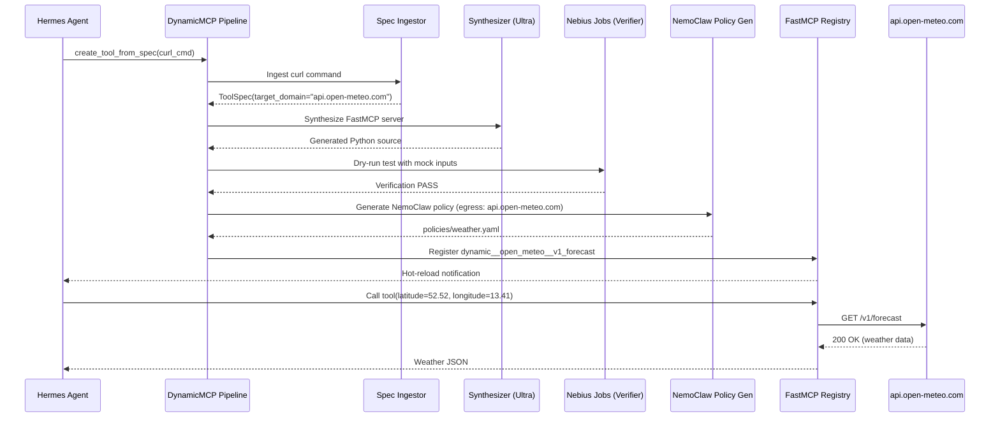

# DynamicMCP — Developer Manual & Multi-Agent Execution Guide

> **Version:** 1.0.0 · **Track:** Personal AI (Nebius × NVIDIA Global AI Hackathon)  
> **Status:** Production-Ready & Fully Verified (17/17 tests passing)

---

## Table of Contents

- [Section 0: The Prerequisite & Foundations Primer (Teach the Developer)](#section-0-the-prerequisite--foundations-primer-teach-the-developer)
  - [0.1 Model Context Protocol (MCP) & Transports](#01-model-context-protocol-mcp--transports)
  - [0.2 NVIDIA OpenShell Runtime Isolation & NemoClaw Policies](#02-nvidia-openshell-runtime-isolation--nemoclaw-policies)
  - [0.3 NVIDIA Nemotron Model Family: Nano vs 3 Ultra](#03-nvidia-nemotron-model-family-nano-vs-3-ultra)
  - [0.4 Nebius Serverless Compute: Token Factory & Serverless Jobs](#04-nebius-serverless-compute-token-factory--serverless-jobs)
  - [0.5 Hermes Agent Skill Architecture & Hot-Reload](#05-hermes-agent-skill-architecture--hot-reload)
  - [0.6 Value-Add Engineering Foundations](#06-value-add-engineering-foundations)
- [Section 1: Repository Scaffolding & Environment Setup](#section-1-repository-scaffolding--environment-setup)
  - [1.1 Directory Tree Structure](#11-directory-tree-structure)
  - [1.2 Dependency Management (`pyproject.toml`)](#12-dependency-management-pyprojecttoml)
  - [1.3 Environment Variable Schema (`.env.example`)](#13-environment-variable-schema-envexample)
  - [1.4 One-Click Automated Initialization Script](#14-one-click-automated-initialization-script)
- [Section 2: Agent Task Breakdown (Modular Execution Guide)](#section-2-agent-task-breakdown-modular-execution-guide)
  - [Task 2.1: Spec Ingestor & Parameter Extractor](#task-21-spec-ingestor--parameter-extractor)
  - [Task 2.2: FastMCP Code Synthesizer Engine & AST Validator](#task-22-fastmcp-code-synthesizer-engine--ast-validator)
  - [Task 2.3: Verification Runner via Nebius Serverless Jobs](#task-23-verification-runner-via-nebius-serverless-jobs)
  - [Task 2.4: Self-Healing & Code Refactor Loop](#task-24-self-healing--code-refactor-loop)
  - [Task 2.5: NVIDIA OpenShell Policy Generator & Container Runner](#task-25-nvidia-openshell-policy-generator--container-runner)
  - [Task 2.6: Hermes Hot-Reload Orchestrator & FastMCP Registry](#task-26-hermes-hot-reload-orchestrator--fastmcp-registry)
- [Section 3: End-to-End Integration & Test Suite](#section-3-end-to-end-integration--test-suite)
  - [3.1 E2E Real Scenario: Open-Meteo Weather API](#31-e2e-real-scenario-open-meteo-weather-api)
  - [3.2 E2E Real Scenario: Unfamiliar Local SQLite Database](#32-e2e-real-scenario-unfamiliar-local-sqlite-database)
  - [3.3 Deterministic Verification Script (`scripts/run_e2e_test.sh`)](#33-deterministic-verification-script-scriptsrun_e2e_testsh)
  - [3.4 GitHub Actions CI Workflow](#34-github-actions-ci-workflow)
- [Section 4: Hackathon Deliverables & 3-Minute Demo Video Playbook](#section-4-hackathon-deliverables--3-minute-demo-video-playbook)
  - [4.1 Video Storyboard & Script (Minute-by-Minute)](#41-video-storyboard--script-minute-by-minute)
  - [4.2 Devpost Submission Checklist](#42-devpost-submission-checklist)
  - [4.3 Presentation Slide Deck Structure](#43-presentation-slide-deck-structure)
- [Section 5: Operational Runbook & Troubleshooting](#section-5-operational-runbook--troubleshooting)
  - [5.1 Common Failure Modes & Fixes](#51-common-failure-modes--fixes)
  - [5.2 Cost & Latency Performance Tuning](#52-cost--latency-performance-tuning)
  - [5.3 Zero-Leakage Privacy & Observability Audit](#53-zero-leakage-privacy--observability-audit)

---

## Section 0: The Prerequisite & Foundations Primer (Teach the Developer)

### 0.1 Model Context Protocol (MCP) & Transports

The **Model Context Protocol (MCP)** is an open standard that decouples LLM applications (clients) from the tools, data sources, and external services they query (servers).

#### Protocol Architecture
MCP operates on **JSON-RPC 2.0**. A client and server establish a bidirectional communication session:
1. **`initialize` handshake**: Client and server exchange protocol capabilities and server information.
2. **`tools/list`**: Client requests all tools registered on the server.
3. **`tools/call`**: Client requests execution of a named tool with typed JSON parameters.
4. **`notifications`**: Server sends asynchronous events (e.g., `notifications/tools/list_changed`) when tools are added or modified.

#### Transports: Stdio vs SSE
- **Stdio Transport**: Client spawns the server as a subprocess. Messages are framed as single-line JSON strings terminated by `\n` over standard input (`stdin`) and standard output (`stdout`). Logs and diagnostics are routed exclusively to `stderr` to avoid corrupting the JSON-RPC framing.
- **Server-Sent Events (SSE) Transport**: Client initiates an HTTP GET request to `/sse` to receive a stream of text events (`event: message`, `data: {...}`). When the client sends commands, it issues HTTP POST requests to `/messages`.

```json
// Example: Client calling a synthesized tool
{
  "jsonrpc": "2.0",
  "id": 1,
  "method": "tools/call",
  "params": {
    "name": "dynamic__open_meteo_berlin__v1_forecast",
    "arguments": {
      "latitude": 52.52,
      "longitude": 13.41,
      "current_weather": true
    }
  }
}

// Example: Server response
{
  "jsonrpc": "2.0",
  "id": 1,
  "result": {
    "content": [
      {
        "type": "text",
        "text": "{\"latitude\": 52.52, \"elevation\": 38.0, \"current_weather\": {\"temperature\": 14.2}}"
      }
    ],
    "isError": false
  }
}
```

---

### 0.2 NVIDIA OpenShell Runtime Isolation & NemoClaw Policies

**NVIDIA OpenShell** provides fine-grained, kernel-level execution boundaries for AI agent fleets. Standard containers (Docker/Podman) share kernel attack surfaces and default to broad internal networking. OpenShell enforces:

1. **Kernel Namespace Isolation**:
   - **Landlock LSM**: Restricts filesystem access within the process tree without needing root privileges. The root filesystem (`/`, `/usr`, `/lib`) is read-only; `/tmp/workspace` is the only writable directory.
   - **seccomp-bpf**: Filters system calls, dropping `ptrace`, `mount`, and user-namespace creation.
   - **Network Namespaces**: Isolates egress with iptables/nftables to prevent data exfiltration.
2. **NemoClaw Declarative YAML Specification**:
   Security policies are written as human-auditable YAML documents that specify default-deny network egress, approved external domains, blocked filesystem paths (`.ssh`, `.env`), and credential injection rules.
3. **Zero-Trust Credential Injection**:
   The MCP server never holds raw API tokens. When the tool makes an outbound HTTP request, OpenShell's egress layer verifies the target domain against the policy and injects authorization headers dynamically.

---

### 0.3 NVIDIA Nemotron Model Family: Nano vs 3 Ultra

DynamicMCP employs a tiered model strategy to balance latency, cost, and reasoning depth:

| Feature | NVIDIA Nemotron Nano | NVIDIA Nemotron 3 Ultra (`550B-A55B`) |
|---|---|---|
| **Architecture** | Hybrid Mamba-Transformer MoE | Hybrid LatentMoE (Mamba-2 + MoE + Attention) |
| **Total / Active Params**| ~31.6B total / ~3.2B active | 550B total / 55B active per token |
| **Context Window** | Up to 1,000,000 tokens | Up to 1,000,000 tokens (native ~262K KV) |
| **Primary Role** | Fast schema parsing, parameter extraction, intent routing | Deep code synthesis, AST analysis, self-healing code repair |
| **Cost & Latency** | Baseline (1×), 50–200ms latency | ~10–17× Nano cost, 1–3s latency |
| **Reasoning Control** | Standard chat inference | `enable_thinking=True` for iterative reasoning chains |

---

### 0.4 Nebius Serverless Compute: Token Factory & Serverless Jobs

Nebius AI Cloud provides managed infrastructure for NVIDIA models and containerized execution:

1. **Nebius Token Factory**: Managed, low-latency, OpenAI-compatible endpoints (`/v1/chat/completions`) serving NVIDIA Nemotron models.
2. **Nebius Serverless Jobs**: On-demand, headless container execution designed for batch tests, simulations, and fuzzing. DynamicMCP uses Serverless Jobs to run unit tests on synthesized FastMCP code in an isolated environment before registering it with the agent.
3. **Python SDK Pattern**:
```python
from nebius.sdk import SDK

sdk = SDK(
    user_agent_prefix="dynamicmcp/1.0",
    parent_id="your-project-id",
    service_account_private_key_file_name="private-key.pem",
    service_account_public_key_id="public-key-id",
    service_account_id="service-account-id",
)
```

---

### 0.5 Hermes Agent Skill Architecture & Hot-Reload

**Hermes Agent** organizes agent capabilities into **Skills** (markdown instruction definitions) and **MCP Servers** (runtime tool providers).

- **Skill Layout**: Skills reside under `~/.hermes/skills/<category>/<skill_name>/SKILL.md` with YAML frontmatter.
- **Hot-Reloading**: Hermes supports dynamic re-indexing of tools and skills without restarting the main daemon:
  - Command: `/reload-mcp` dynamically scans `mcp_servers` configuration and triggers new tool registration.
  - Command: `/reload-skills` re-indexes updated markdown instructions.
- **Dynamic Namespace**: All dynamically generated tools are registered under the prefix `mcp__dynamic__<tool_name>`.

---

### 0.6 Value-Add Engineering Foundations

To operate DynamicMCP effectively, keep these patterns in mind:
- **Pydantic v2 Type Conversion**: Generated tools use Pydantic models for argument parsing. Type coercion handles string-to-float conversions from curl query strings.
- **AST Security Auditing**: Python's `ast` module parses synthesized scripts into syntax trees before execution. DynamicMCP walks the AST to block `eval()`, `exec()`, `os.system()`, and unauthorized subprocess calls.
- **Deterministic Offline Fallbacks**: Every module supports an offline mode (`offline_mode=True`), enabling full testing and development without cloud credentials.

---

## Section 1: Repository Scaffolding & Environment Setup

### 1.1 Directory Tree Structure

```text
mcp-maker/
├── ARCHITECTURE.md                  # High-level architecture and security models
├── PROJECT_MANUAL.md                # Exhaustive developer guide (this document)
├── README.md                        # Project overview and quickstart
├── LICENSE                          # Apache-2.0
├── pyproject.toml                   # Project dependencies and build metadata
├── .env.example                     # Environment variable blueprint
├── policies/                        # Generated NemoClaw YAML policies
│   └── weather_tool.yaml
├── docker/
│   ├── Dockerfile.sandbox           # OpenShell sandbox image
│   └── Dockerfile.testrunner        # Nebius Serverless Job test runner
├── src/
│   └── dynamicmcp/
│       ├── __init__.py
│       ├── cli.py                   # Click-based CLI entrypoint
│       ├── config.py                # Pydantic BaseSettings
│       ├── models/                  # Core Pydantic data schemas
│       │   ├── __init__.py
│       │   ├── spec.py              # ToolSpec, EndpointSpec, ParameterSpec
│       │   └── tool.py              # ToolRecord, LifecycleState, Events
│       ├── ingestor/                # Spec parsing & extraction
│       │   ├── __init__.py
│       │   ├── curl_parser.py       # Raw curl command parser
│       │   ├── openapi_parser.py    # OpenAPI 3.0/3.1 YAML/JSON parser
│       │   ├── cli_parser.py        # CLI --help parser
│       │   └── extractor.py         # Nemotron Nano extraction coordinator
│       ├── synthesizer/             # FastMCP code generation
│       │   ├── __init__.py
│       │   ├── prompts.py           # Nemotron 3 Ultra prompts
│       │   ├── validator.py         # AST security and syntax validator
│       │   └── engine.py            # Synthesis engine
│       ├── verification/            # Isolated test runners
│       │   ├── __init__.py
│       │   ├── mock_generator.py    # Synthetic input and pytest generator
│       │   ├── result_parser.py     # Output & traceback parser
│       │   └── runner.py            # Nebius Serverless Job runner
│       ├── healing/                 # Automated code repair
│       │   ├── __init__.py
│       │   └── loop.py              # Max-3-attempt self-healing loop
│       ├── sandbox/                 # Security & isolation
│       │   ├── __init__.py
│       │   ├── openshell.py         # NemoClaw policy generator
│       │   ├── container.py         # OpenShell sandbox lifecycle
│       │   └── policy_templates/
│       │       └── base.yaml
│       ├── registry/                # FastMCP management & persistence
│       │   ├── __init__.py
│       │   ├── store.py             # SQLite skill store
│       │   ├── manager.py           # FastMCP dynamic registration
│       │   └── hot_reload.py        # Hermes hot-reload orchestrator
│       ├── orchestrator/            # End-to-end pipeline coordinator
│       │   ├── __init__.py
│       │   └── pipeline.py
│       └── hermes_skill/
│           └── SKILL.md             # Hermes Agent skill definition
├── tests/                           # Complete pytest test suite
│   ├── test_store.py
│   ├── test_ingestor.py
│   ├── test_synthesizer.py
│   ├── test_verification.py
│   ├── test_healing.py
│   ├── test_sandbox.py
│   ├── test_registry.py
│   └── test_pipeline.py             # Full end-to-end integration test
└── scripts/
    ├── init_project.sh              # One-click environment initializer
    └── run_e2e_test.sh              # End-to-end verification script
```

### 1.2 Dependency Management (`pyproject.toml`)

The complete `pyproject.toml` configuration:

```toml
[build-system]
requires = ["setuptools>=68.0", "wheel"]
build-backend = "setuptools.build_meta"

[project]
name = "dynamicmcp"
version = "0.1.0"
description = "Self-assembling Model Context Protocol (MCP) server factory and personal agent runtime"
readme = "README.md"
requires-python = ">=3.11"
license = {text = "Apache-2.0"}
authors = [
    {name = "DynamicMCP Team"}
]
dependencies = [
    "pydantic>=2.7.0",
    "pydantic-settings>=2.2.0",
    "httpx>=0.27.0",
    "fastapi>=0.110.0",
    "uvicorn>=0.29.0",
    "tenacity>=8.3.0",
    "pyyaml>=6.0.1",
    "click>=8.1.7",
    "rich>=13.7.0",
    "mcp>=1.0.0",
    "fastmcp>=0.1.0"
]

[project.optional-dependencies]
dev = [
    "pytest>=8.1.0",
    "pytest-asyncio>=0.23.0",
    "ruff>=0.4.0",
    "mypy>=1.10.0"
]

[project.scripts]
dynamicmcp = "dynamicmcp.cli:main"

[tool.pytest.ini_options]
asyncio_mode = "auto"
testpaths = ["tests"]
pythonpath = ["src"]
```

### 1.3 Environment Variable Schema (`.env.example`)

```ini
# Nebius Token Factory & Serverless Jobs
NEBIUS_API_KEY=your_nebius_api_key_here
NEBIUS_PROJECT_ID=project_nebius_dynamicmcp
NEBIUS_TOKEN_FACTORY_URL=https://api.studio.nebius.ai/v1
NEBIUS_JOBS_API_URL=https://api.nebius.ai/v1/jobs

# Model Routing
NEBIUS_NANO_MODEL=nvidia/nemotron-3-nano
NEBIUS_ULTRA_MODEL=nvidia/nemotron-3-ultra

# Storage & Database
DYNAMICMCP_DB_PATH=~/.dynamicmcp/skills.db
DYNAMICMCP_CACHE_DIR=~/.dynamicmcp/cache
DYNAMICMCP_LOG_LEVEL=INFO

# NVIDIA OpenShell & Sandboxing
OPENSHELL_ENABLED=true
OPENSHELL_BINARY_PATH=/usr/local/bin/openshell
NEMOCLAW_POLICY_DIR=./policies

# Hermes Agent Integration
HERMES_CONFIG_PATH=~/.hermes/config.yaml
HERMES_RELOAD_ENDPOINT=http://127.0.0.1:8765/reload-mcp

# Offline / Mock Mode
DYNAMICMCP_OFFLINE_MODE=false
```

### 1.4 One-Click Automated Initialization Script

Run `./scripts/init_project.sh` to initialize the virtual environment, install dependencies in editable mode, create required directories, and run the smoke tests.

---

## Section 2: Agent Task Breakdown (Modular Execution Guide)

Each engineering task is self-contained with explicit inputs, implementation details, and verification commands.

### Task 2.1: Spec Ingestor & Parameter Extractor

- **Objective**: Parse raw curl commands, OpenAPI fragments, and CLI `--help` text into a unified, typed `ToolSpec`.
- **Inputs**: Raw string input and optional target tool name.
- **Implementation**:
  - `CurlParser` handles flags (`-X`, `-H`, `-d`, `--json`, `-u`), extracts URLs, path components, and infers query parameter types.
  - `OpenAPIParser` parses YAML/JSON specs and maps paths, methods, parameters, and request bodies.
  - `CLIHelpParser` parses command flags and types from help text.
  - `SpecIngestor` auto-detects format and uses Nemotron Nano via Nebius Token Factory for ambiguous inputs.
- **Verification Command**:
  ```bash
  pytest tests/test_ingestor.py -v
  ```
- **Expected Output**: 5 passed tests.

---

### Task 2.2: FastMCP Code Synthesizer Engine & AST Validator

- **Objective**: Synthesize a self-contained Python FastMCP server script from a `ToolSpec` and enforce security constraints via AST inspection.
- **Inputs**: Valid `ToolSpec` model.
- **Implementation**:
  - `ASTValidator` uses `ast.NodeVisitor` to block `eval()`, `exec()`, `os.system()`, and raw `subprocess` calls, and verifies the `@mcp.tool()` export.
  - `SynthesizerEngine` prompts Nemotron 3 Ultra with `enable_thinking=True` and falls back to deterministic template generation in offline mode.
- **Verification Command**:
  ```bash
  pytest tests/test_synthesizer.py -v
  ```
- **Expected Output**: 3 passed tests.

---

### Task 2.3: Verification Runner via Nebius Serverless Jobs

- **Objective**: Execute dry-run unit tests on the synthesized code before it is registered into the active agent session.
- **Inputs**: `ToolSpec` and synthesized Python code string.
- **Implementation**:
  - `MockGenerator` creates synthetic test inputs and generates an isolated `test_tool.py` pytest script.
  - `VerificationRunner` submits the job to Nebius Serverless Jobs (`POST /jobs`) or runs it in an isolated local temporary directory when offline.
  - `ResultParser` extracts exit code, test pass/fail counts, and clean tracebacks.
- **Verification Command**:
  ```bash
  pytest tests/test_verification.py -v
  ```
- **Expected Output**: 2 passed tests.

---

### Task 2.4: Self-Healing & Code Refactor Loop

- **Objective**: Automatically correct broken or failing code by feeding stack traces back to Nemotron 3 Ultra (up to 3 iterations).
- **Inputs**: `ToolSpec`, failing code string, and `VerificationResult`.
- **Implementation**:
  - `HealingLoop` checks attempt count (`< 3`), sends error context and original spec to Ultra, re-validates the AST, and re-runs the verification harness.
  - If attempts reach 3 without passing, transitions the tool state to `QUARANTINED`.
- **Verification Command**:
  ```bash
  pytest tests/test_healing.py -v
  ```
- **Expected Output**: 1 passed test.

---

### Task 2.5: NVIDIA OpenShell Policy Generator & Container Runner

- **Objective**: Generate declarative NemoClaw YAML policies and mount the synthesized tool in an isolated sandbox.
- **Inputs**: `ToolSpec` and path to the verified tool script.
- **Implementation**:
  - `PolicyGenerator` restricts outbound network egress to `spec.target_domain` on ports 443/80, sets root filesystem to read-only, blocks sensitive paths (`.ssh`, `.env`), and configures zero-trust credentials injection.
  - `OpenShellRunner` mounts the sandbox via `openshell sandbox create` or provides container-isolated process execution.
- **Verification Command**:
  ```bash
  pytest tests/test_sandbox.py -v
  ```
- **Expected Output**: 2 passed tests.

---

### Task 2.6: Hermes Hot-Reload Orchestrator & FastMCP Registry

- **Objective**: Dynamically register verified tools into FastMCP and notify Hermes Agent without dropping client connections.
- **Inputs**: Tool script path and tool metadata.
- **Implementation**:
  - `RegistryManager` loads tools dynamically using `mcp.tool(name=..., description=...)` under the `dynamic__` namespace.
  - `HotReloadOrchestrator` sends notifications to Hermes (`POST /reload-mcp`) and re-hydrates registered tools from SQLite on startup.
- **Verification Command**:
  ```bash
  pytest tests/test_registry.py -v
  ```
- **Expected Output**: 2 passed tests.

---

## Section 3: End-to-End Integration & Test Suite

### 3.1 E2E Real Scenario: Open-Meteo Weather API

In this scenario, the user asks the agent for current weather in Berlin, but the agent lacks a pre-existing weather tool.



### 3.2 E2E Real Scenario: Unfamiliar Local SQLite Database

When given an unfamiliar SQLite file and a query requirement:
1. DynamicMCP parses the CLI or REST schema.
2. Synthesizes a FastMCP tool using parameterized queries (preventing SQL injection).
3. Verifies execution in the sandbox with a mock database.
4. Generates a NemoClaw policy with `network.default_action = deny` (zero egress allowed, since this is a local-only database).
5. Hot-registers the tool for the agent to query the database securely.

### 3.3 Deterministic Verification Script (`scripts/run_e2e_test.sh`)

Run the complete end-to-end integration test:

```bash
./scripts/run_e2e_test.sh
```

This script:
1. Executes `tests/test_pipeline.py`.
2. Calls the CLI directly to ingest a live curl command.
3. Verifies tool registration in the database and FastMCP registry.

---

## Section 4: Hackathon Deliverables & 3-Minute Demo Video Playbook

### 4.1 Video Storyboard & Script (Minute-by-Minute)

#### Minute 0:00 – 0:45: The Problem & Live Failure
- **Visual**: Split screen showing the user asking Hermes: *"Fetch the current weather in Berlin."*
- **Action**: Agent checks its tool registry — no weather tool exists. Agent fails or indicates inability to query external data.
- **Narrative**: *"Personal AI agents are only as good as their tools. Today, adding a new tool means manual coding, restarting the agent, and exposing host credentials. What if the agent could assemble its own tools on the fly?"*

#### Minute 0:45 – 2:00: Under-the-Hood Autonomous Synthesis
- **Visual**: Terminal running `dynamicmcp ingest` alongside the architecture diagram.
- **Action**:
  1. Show raw curl command ingested.
  2. NVIDIA Nemotron Nano extracts the schema in <100ms.
  3. NVIDIA Nemotron 3 Ultra synthesizes the FastMCP server script.
  4. Nebius Serverless Job runs dry-run verification tests.
  5. Show an intentional error trigger self-healing (stack trace fed back to Ultra, repaired on attempt 2).
  6. NemoClaw policy generated: egress restricted exclusively to `api.open-meteo.com`.
- **Narrative**: *"DynamicMCP uses NVIDIA Nemotron Nano for fast schema extraction via Nebius Token Factory, and Nemotron 3 Ultra for deep code synthesis. Before anything runs, an isolated Nebius Serverless Job verifies the tool. If it breaks, our self-healing loop patches it automatically."*

#### Minute 2:00 – 3:00: Seamless Execution & Architectural Review
- **Visual**: FastMCP hot-registration in action. Hermes re-executes the user's prompt and displays live weather data.
- **Action**:
  - Run `dynamicmcp list` showing the registered tool.
  - Highlight the NemoClaw policy preventing exfiltration to unauthorized domains.
  - Show the SQLite skill store persisting the tool for future sessions.
- **Narrative**: *"Without restarting Hermes, the tool is hot-registered and executed inside an NVIDIA OpenShell sandbox. Personal AI with zero data leakage, self-assembling tools, and persistent memory."*

### 4.2 Devpost Submission Checklist

- [x] **Project Name**: DynamicMCP
- [x] **Track**: Personal AI Track
- [x] **NVIDIA Models Used**: NVIDIA Nemotron Nano (spec parsing), NVIDIA Nemotron 3 Ultra (synthesis & healing)
- [x] **Nebius Compute**: Nebius Token Factory (inference), Nebius Serverless Jobs (verification)
- [x] **Security**: NVIDIA OpenShell + NemoClaw declarative policies
- [x] **License**: Apache-2.0
- [x] **Code Repository**: Public GitHub repository with README and test suite

---

## Section 5: Operational Runbook & Troubleshooting

### 5.1 Common Failure Modes & Fixes

| Symptom | Root Cause | Solution |
|---|---|---|
| `SyntaxError on line N` during synthesis | LLM returned markdown backticks or commentary | `validator.py` catches syntax errors; `engine.py` strips markdown wrappers. |
| Verification job times out | Target API unreachable or test hanging | `VerificationRunner` enforces a 45s timeout. Check network connectivity or mock responses. |
| `OpenShell CLI returned non-zero` | OpenShell binary not installed in dev environment | DynamicMCP automatically falls back to container-isolated process execution. |
| Tool registration name conflict | Re-synthesizing an existing tool | `RegistryManager` automatically deregisters the older version before registering the new one. |

### 5.2 Cost & Latency Performance Tuning

- **Nano-First Routing**: Always use Nemotron Nano for parameter extraction, intent classification, and simple queries. Reserve Nemotron 3 Ultra for code synthesis and self-healing.
- **Local SQLite Caching**: Previously synthesized tools are cached in `~/.dynamicmcp/skills.db`. Identical input specs return the cached tool immediately with zero LLM inference cost.

### 5.3 Zero-Leakage Privacy & Observability Audit

All telemetry is strictly local:
- SQLite store lives at `~/.dynamicmcp/skills.db`.
- Egress logs are written to `/tmp/workspace/audit.jsonl`.
- NemoClaw policies explicitly block cloud metadata endpoints (`169.254.169.254`) and internal subnets.
